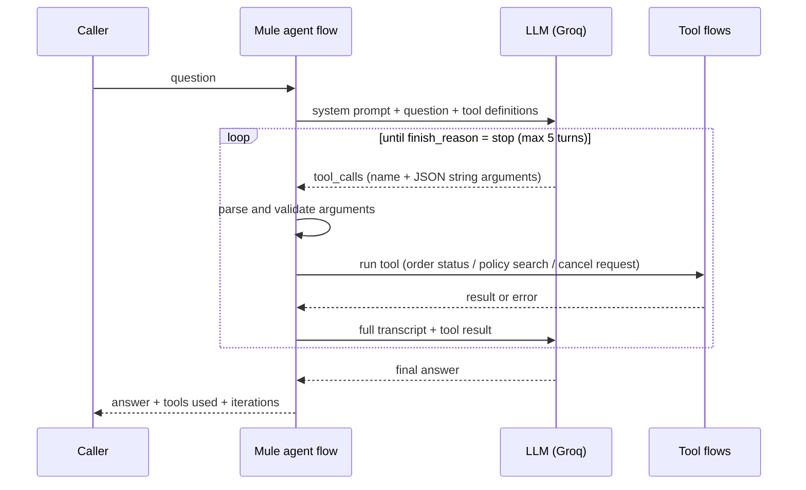

# AI RAG and Agents on Mule 4

Hands-on project showing how to build AI features in MuleSoft: retrieval-augmented generation (RAG) over a vector database, and an LLM agent that calls tools. Everything runs on a laptop (Mule runtime, PostgreSQL with pgvector, local Ollama embeddings, Groq for generation).

## What it demonstrates

| Area | Where | What it shows |
|---|---|---|
| Direct LLM call | `Gemini-LLM-call.xml`, `direct-llm-call.xml` | Calling an LLM REST API from Mule, structured output |
| RAG, local store | `rag-poc.xml`, `rag-multi-doc.xml` | Chunking, embeddings, retrieval with visible scores, grounded answers, `source` |
| RAG, pgvector | `rag-pgvector.xml` | External vector store, metadata filters, `minScore` gate, graceful degradation |
| Tool calling | `tool-calling.xml`, `tool-calling-agent.xml`, `tool-calling-agent-v2.xml` | LLM chooses tools, Mule executes them, validated and capped agent loop |
| Evaluation | `rag-eval/` | Repeatable retrieval and end-to-end checks |

## Architecture

```
INGEST   documents -> chunk (300 chars, 50 overlap, word-boundary snapping)
         -> embed (Ollama all-minilm, 384 dims) -> PostgreSQL + pgvector

ASK      question -> embed -> cosine search (+ optional metadata filters)
         -> minScore gate -> LLM (Groq) answers only from the retrieved chunks
         -> { answer, source, grounded, retrievedChunks }

AGENT    question + tool definitions -> LLM replies "call tool X"
         -> Mule validates and runs the tool -> result goes back to the LLM
         -> loop until the LLM answers (max 5 turns)
```

### Agent loop



The LLM is stateless, so every call resends the whole transcript.

## Design decisions and trade-offs

- **Chunking:** 300 characters with 50 overlap, cut at word boundaries. Trade-off: character counts ignore sentence and heading structure, so a chunk can split an idea. Raw character slicing cut words in half and made the LLM answer wrongly; recursive DataWeave functions snap each cut to whitespace.
- **Score gate:** retrieval scores for in-scope paraphrases and out-of-scope questions overlap, so no fixed threshold separates them. `minScore` (0.3) only filters nonsense; the grounding prompt ("answer only from context, otherwise say I do not know") is the real guard.
- **Grounded responses:** every answer carries `grounded` and `source`; both are null/false when nothing relevant was found, so callers never get a confident guess.
- **Re-indexing:** a re-ingest deletes all rows and inserts again, which is not atomic; a failure in the middle leaves an empty or partial index. Fixing it means loading into a new version and switching over.
- **Failure design:** LLM unavailable returns a degraded response with the top excerpt; vector database unavailable fails closed with no answer.
- **Metadata filtering** uses nullable bind parameters with `CAST(:param AS varchar)`, which avoids a Postgres/JDBC "could not determine data type" error.
- **Tool calling:** the LLM never executes anything; Mule does. Tool arguments are parsed and validated, errors are returned to the LLM as tool results, there is an iteration cap, and the write tool (`cancel_order`) only creates a request that a human must approve.

## Verified behaviour

| Area | Result |
|---|---|
| Retrieval (12 questions over the sample documents) | hit@1 62%, hit@3 100% |
| End to end (12 questions) | 12 of 12 answered correctly |
| Out-of-scope question to RAG | Retrieval scores overlap with in-scope paraphrases (0.69 to 0.75 vs 0.648), so the grounding prompt, not the score, produces "I do not know" |
| Tool calling, one tool: "Where is ORD-1042?" | LLM asks for `get_order_status`, Mule runs it, final answer states PROCESSING |
| Tool calling, unknown order ORD-9999 | Tool returns NOT_FOUND and the answer says so |
| Tool calling, "What is the capital of France?" | No tool call, direct answer (`finish_reason` = stop) |
| Observed risk | In one run the LLM added detail that was not in the tool result ("tracking details"); mitigated by a stricter system prompt, not eliminated |
| Agent loop, "Where is ORD-1042 and can I still cancel it?" | Two tool rounds (3 LLM calls). Final answer correct, but the LLM called `cancel_order` for a question and skipped `search_policy` |
| Agent loop, "Please cancel order ORD-1043" | `cancel_order` only, returned as a simulated request with no order changed; the LLM did not check the status first |
| Agent loop, "Check order 12345" | Argument validation rejected the id, the error went back as the tool result, the LLM asked the user for a valid id |
| Agent loop, "What is the capital of France?" | No tool, `iterations` 0 |
| Agent loop v2 (`/agent/loop2`), the first question again | Tightened tool descriptions and system prompt: used `get_order_status` and `search_policy`, no `cancel_order`; grounded policy answer |
| Agent loop v2, vector database stopped | `search_policy` returned a degraded result and the LLM said the policy service was unavailable instead of inventing a policy |
| Agent loop v2, `maxIterations` set to 1 on a two-round question | Stopped with "Stopped: tool call limit reached." after one round |

Not yet exercised: several tool calls in one LLM reply, and an unknown tool name.

## Endpoints (HTTPS, port 8081)

| Endpoint | Purpose |
|---|---|
| `POST /rag/ingest`, `POST /rag/ask`, `POST /rag/search` | Local-store RAG; `search` is retrieval only (no LLM) |
| `POST /rag/pgvector/ingest` | Chunk, embed and load the policy documents into pgvector |
| `POST /rag/pgvector/ask` | Question; optional `topK`, `domain`, `documentType`, `version`, `minScore` |
| `POST /agent/step1` | Shows the raw tool-call request from the LLM |
| `POST /agent/ask` | One tool, one round trip |
| `POST /agent/loop` | Three tools (`get_order_status`, `search_policy`, `cancel_order`), validated loop |
| `POST /agent/loop2` | Same loop with tighter tool descriptions and prompt; optional `maxIterations` in the body |

## Run it

Prerequisites: Java 17, Maven, Anypoint Code Builder or a Mule 4.11+ runtime, Docker, Ollama, a Groq API key.

1. **Database**
   ```
   docker run -d --name rag-pgvector -e POSTGRES_USER=rag -e POSTGRES_PASSWORD=<choose> -e POSTGRES_DB=ragdb -p 5433:5432 pgvector/pgvector:pg16
   docker exec -i rag-pgvector psql -U rag -d ragdb < db/schema.sql
   ```
2. **Embeddings:** `ollama pull all-minilm` and keep `ollama serve` running.
3. **Config:** copy `src/main/resources/config-example.yaml` to `config.yaml` and add your keys; copy `secure-example.yaml` to `secure.yaml` with your encrypted DB password (Secure Properties Tool, AES/CBC). Start the runtime with `-M-Dsecure.key=<your key>`.
4. **TLS:** create a local keystore at `src/main/resources/tls/server-keystore.p12` (alias `mule-server`, password `changeit` for local use only), for example with `keytool -genkeypair`.
5. **Run** the app, then load the documents:
   ```
   curl -k -X POST https://localhost:8081/rag/pgvector/ingest -H 'Content-Type: application/json' -d '{}'
   curl -k -X POST https://localhost:8081/rag/pgvector/ask -H 'Content-Type: application/json' -d '{"question":"Can I cancel an order after it has shipped?"}'
   curl -k -X POST https://localhost:8081/agent/loop -H 'Content-Type: application/json' -d '{"question":"Where is ORD-1042 and can I still cancel it?"}'
   ```
6. **Evaluate:** `python3 rag-eval/run_eval.py` (retrieval hit@K) and `python3 rag-eval/run_eval_ask.py` (end to end).

Measured on the sample documents: retrieval hit@1 62%, hit@3 100%; end-to-end 12/12 questions passed.

## Layout

```
src/main/mule/      Mule flows (one file per topic)
src/main/resources/ sample policy documents, config templates, log4j2
db/schema.sql       pgvector table
rag-eval/           evaluation questions and runners
```

## Security notes

No real keys are committed. `config.yaml`, `secure.yaml`, keystores and keys are git-ignored. The tool stubs return hard-coded demo orders.
